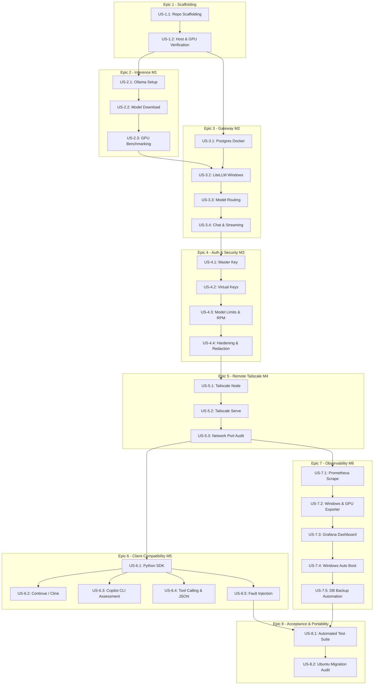

# [US-8.2] Ubuntu Server 24.04 LTS Portability Audit & Decoupling Checklist

## User Story Statement
- **Role:** As a Systems Architect
- **Goal:** I want to verify that all configurations, logical names, and compose files remain decoupled from Windows OS quirks
- **Benefit:** So that migrating to Ubuntu Server 24.04 LTS in the future requires zero changes to client configurations or database schemas.

#### Technical Scope & Context
Audit the architecture against the portability principles in ADR §2 & §16. Verify:
- Client-facing API contract and base URLs are decoupled from the OS.
- Compose files use standard POSIX-compatible mount syntax.
- Linux equivalent lifecycle scripts (`scripts/linux/start.sh`, `scripts/linux/stop.sh`, `scripts/linux/health-check.sh`) are drafted and mirror Windows operational intent.
- Model aliases and virtual keys are strictly portable.

#### Detailed Tasks
1. Draft Linux lifecycle scripts in `scripts/linux/`:
   - `start.sh` (systemd / docker compose)
   - `stop.sh`
   - `health-check.sh`
2. Audit `config/litellm/config.yaml` to ensure no Windows-specific absolute paths are hardcoded.
3. Document Ubuntu migration runbook in `docs/ubuntu-migration-guide.md` covering NVIDIA container toolkit, systemd services, and Docker Compose deployment.

#### Acceptance Criteria
- **Scenario 1: Portability Verification**
  - **Given** the configuration files and compose specifications
  - **When** inspected against Linux deployment requirements
  - **Then** zero Windows file path delimiters (`\`) or Windows-specific flags exist in shared configs (`config.yaml`, `compose.yaml`).
- **Scenario 2: Migration Runbook Completeness**
  - **Given** `docs/ubuntu-migration-guide.md`
  - **When** followed step-by-step
  - **Then** it contains complete commands for driver install, systemd setup, database restore, and test execution.

#### Definition of Done
- Linux lifecycle scripts drafted, shared configs audited, migration guide completed.

---

## Story Dependencies & Execution Roadmap

---

## Definition of Done (Global DoD Checklist)

For any User Story to be marked as **Completed**:
- [ ] **Code / Config Completed:** All YAML, PowerShell, Python, or SQL files are created in the target repository directory.
- [ ] **No Committed Secrets:** Secrets are read from `.env` or environment variables; no raw API keys or passwords in Git.
- [ ] **Acceptance Criteria Met:** All scenarios under the story's Acceptance Criteria have been manually or automatically verified.
- [ ] **Error Handling:** Graceful failures with informative logging; no uncaught script terminations.
- [ ] **Documentation:** Setup, commands, or operational changes are reflected in relevant markdown docs.
- [ ] **Regression & Isolation:** No unintended network ports exposed outside localhost/tailnet.

---
*Generated from [tasks-breakdown-user-stories.md](tasks-breakdown-user-stories.md)*
