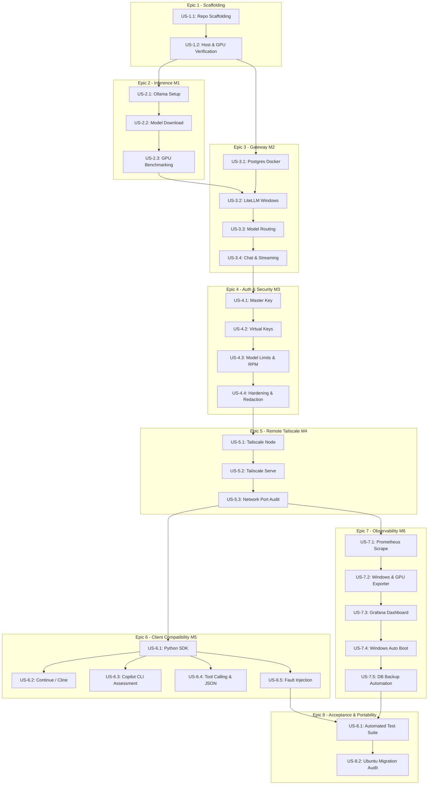

# Local LLM Inference Gateway — User Stories & Task Breakdown

**Document Version:** 1.0  
**Date:** 2026-11-22  
**Baseline Design Document:** [local-llm-gateway-design-latest.md](file:///D:/Sources/my-llm-gateway/local-llm-gateway-design-latest.md)  
**Host Target:** `DESKTOP-E9DFIES` (Windows 11/10 x64, Intel i5-11400F, 32GB RAM, RTX 3060 12GB)  
**Architecture:** Windows Native (Ollama + LiteLLM Proxy) + Docker Desktop (PostgreSQL, Prometheus, Grafana) + Tailscale Serve

---

## Executive Summary & Epic Structure

This document breaks down the implementation plan defined in the Architecture Decision Record (ADR) into actionable Epics, User Stories, and Engineering Tasks. Each story follows standard Agile specification format with clear technical contexts, granular subtasks, strict acceptance criteria (Given/When/Then), dependencies, and Definition of Done (DoD).

```
├── Epic 1: Repository Scaffolding & Host Environment Verification
│   ├── US-1.1: Project Directory Structure & Version Control Setup
│   └── US-1.2: Host Hardware, GPU Drivers & Container Runtime Verification
├── Epic 2 (M1): Local Inference Engine Setup & Benchmarking
│   ├── US-2.1: Ollama Installation & Windows Service Lifecycle
│   ├── US-2.2: Initial Model Download & Tag Verification
│   └── US-2.3: GPU Acceleration, Memory Footprint & Latency Benchmarking
├── Epic 3 (M2): Gateway Deployment & Core Routing Engine
│   ├── US-3.1: PostgreSQL Persistent Database Deployment via Docker Compose
│   ├── US-3.2: LiteLLM Proxy Native Windows Installation & Environment Setup
│   ├── US-3.3: Model Mapping, Abstraction & Provider Configuration
│   └── US-3.4: OpenAI API Compatibility & Server-Sent Events (SSE) Streaming
├── Epic 4 (M3): Identity, Authorization & Gateway Security Hardening
│   ├── US-4.1: Master Key & Administrative Credential Isolation
│   ├── US-4.2: Client Virtual API Key Lifecycle Management
│   ├── US-4.3: Per-Key Model Access Control, Rate Limiting & Concurrency Controls
│   └── US-4.4: Security Hardening, Payload Limits & Sensitive Data Redaction
├── Epic 5 (M4): Private Remote Access via Tailscale
│   ├── US-5.1: Tailscale Node Configuration & Access Control (ACL/Grants)
│   ├── US-5.2: Tailscale Serve Private HTTPS Ingress Setup
│   └── US-5.3: Network Exposure Audit & Port Lockdown Verification
├── Epic 6 (M5): Client Integration & Upstream Robustness
│   ├── US-6.1: OpenAI Python SDK & Standard Client Verification
│   ├── US-6.2: IDE AI Assistant Integrations (Continue & Cline)
│   ├── US-6.3: GitHub Copilot Integration & Capability Assessment
│   ├── US-6.4: Tool Calling & JSON Structured Output Verification
│   └── US-6.5: Fault Injection, Timeout Handling & Error Propagation
├── Epic 7 (M6): Observability, Telemetry & Operational Lifecycle
│   ├── US-7.1: Prometheus Monitoring Stack & LiteLLM Metrics Scraping
│   ├── US-7.2: Windows Host & NVIDIA GPU Telemetry Exporters
│   ├── US-7.3: Grafana Operational Dashboard & Alerting Rules
│   ├── US-7.4: Automated System Boot Lifecycle & Process Supervision
│   └── US-7.5: PostgreSQL Database Backup & Disaster Recovery Automation
└── Epic 8: Acceptance Test Suite & Ubuntu Migration Readiness
    ├── US-8.1: Automated End-to-End Acceptance Test Suite (PowerShell)
    └── US-8.2: Ubuntu Server 24.04 LTS Portability Audit & Decoupling Checklist
```

---

## Epic 1: Repository Scaffolding & Host Environment Verification

### US-1.1: Project Directory Structure & Version Control Setup
- **Role:** As a DevOps engineer / Developer
- **Goal:** I want to establish a clean, standardized repository structure, gitignore, and configuration templates
- **Benefit:** So that all service configs, automation scripts, and deployment files are versioned securely without risking credential exposure.

#### Technical Scope & Context
Establish the repository hierarchy defined in ADR §12. Ensure `.gitignore` ignores `.env`, private keys, secrets, database data files, log dumps, and model caches. Create `.env.example` defining all required configuration variables without real secrets.

#### Detailed Tasks
1. Initialize Git repository in `D:\Sources\my-llm-gateway` (if not already initialized).
2. Create directories:
   - `config/litellm/`
   - `config/monitoring/grafana/`
   - `deployment/postgres/`
   - `scripts/windows/`
   - `scripts/linux/`
   - `tests/`
3. Create `.gitignore` to exclude `.env`, `*.log`, `*.db`, `postgres_data/`, `certs/`, and credentials.
4. Create `.env.example` containing placeholders: `LITELLM_MASTER_KEY`, `LITELLM_SALT_KEY`, `DATABASE_URL`, `POSTGRES_USER`, `POSTGRES_PASSWORD`, `POSTGRES_DB`, `TAILSCALE_HOSTNAME`.
5. Create initial `README.md` documenting project structure, prerequisites, and quick links.

#### Acceptance Criteria
- **Scenario 1: Clean Git Scaffolding**
  - **Given** the project workspace directory `D:\Sources\my-llm-gateway`
  - **When** `git status` is executed
  - **Then** all directories and template files exist, and untracked secret files are properly ignored.
- **Scenario 2: Sensitive Information Protection**
  - **Given** a newly created `.env` file containing test secrets
  - **When** `git status` or `git add .` is executed
  - **Then** Git must ignore `.env` and prevent committing sensitive material.

#### Definition of Done
- Directory structure matches ADR §12.
- `.gitignore` and `.env.example` are committed to the repository.

---

### US-1.2: Host Hardware, GPU Drivers & Container Runtime Verification
- **Role:** As a Systems Administrator
- **Goal:** I want to verify that the host OS, NVIDIA display drivers, CUDA runtime, and Docker Desktop are operational
- **Benefit:** So that the machine is confirmed capable of running hardware-accelerated local inference and Dockerized supporting services.

#### Technical Scope & Context
Confirm `DESKTOP-E9DFIES` environment: Intel i5-11400F, 32 GB RAM, NVIDIA GeForce RTX 3060 12GB VRAM. Verify NVIDIA driver (supports CUDA >= 12.0), PowerShell 7 or Windows PowerShell 5.1+, and Docker Desktop with WSL2 backend.

#### Detailed Tasks
1. Run `nvidia-smi` to confirm GPU detection, VRAM capacity (12,288 MB), and driver/CUDA versions.
2. Verify Docker Desktop installation and start status (`docker --version`, `docker compose version`).
3. Verify Docker WSL2 backend memory limit and container execution (`docker run --rm hello-world`).
4. Document the baseline driver and system info in `scripts/windows/health-check.ps1` host check function.

#### Acceptance Criteria
- **Scenario 1: GPU and Driver Status**
  - **Given** Windows host `DESKTOP-E9DFIES`
  - **When** running `nvidia-smi`
  - **Then** NVIDIA GeForce RTX 3060 with 12 GB VRAM is detected, and CUDA version is >= 12.2.
- **Scenario 2: Docker Engine Readiness**
  - **Given** Docker Desktop is running
  - **When** executing `docker compose version`
  - **Then** Docker Compose v2.x returns success without daemon communication errors.

#### Definition of Done
- GPU details and driver versions logged.
- Docker Desktop verified functional with hello-world test.

---

## Epic 2 (M1): Local Inference Engine Setup & Benchmarking

### US-2.1: Ollama Installation & Windows Service Lifecycle
- **Role:** As an AI Platform Engineer
- **Goal:** I want to install and configure Ollama natively on Windows bound exclusively to localhost (`127.0.0.1:11434`)
- **Benefit:** So that local LLM models can run with low overhead and full GPU acceleration without exposing the raw inference daemon to the network.

#### Technical Scope & Context
Ollama must run as a native Windows process. By default, Ollama binds to `127.0.0.1:11434`. Explicitly ensure `OLLAMA_HOST` is `127.0.0.1:11434` or left default (loopback only). Verify model storage directory path (`OLLAMA_MODELS`) is configured on a drive with sufficient storage (e.g. `D:\OllamaModels` or default `%USERPROFILE%\.ollama\models`).

#### Detailed Tasks
1. Download and install official Ollama for Windows.
2. Verify Ollama executable location and ensure it is accessible in PATH (`ollama --version`).
3. Configure environment variable `OLLAMA_MODELS` if model storage needs to be designated to a dedicated partition.
4. Verify port binding using `netstat -ano | findstr 11434` or `Get-NetTCPConnection -LocalPort 11434` to guarantee binding is loopback only (`127.0.0.1`), not `0.0.0.0`.
5. Create PowerShell lifecycle helper functions in `scripts/windows/start.ps1` and `scripts/windows/stop.ps1` to start/stop Ollama.

#### Acceptance Criteria
- **Scenario 1: Ollama Service Loopback Binding**
  - **Given** Ollama is running on the host
  - **When** inspecting local listeners on port 11434
  - **Then** the local address is `127.0.0.1:11434` (or `[::1]:11434`) and NOT `0.0.0.0:11434`.
- **Scenario 2: Ollama Local API Availability**
  - **Given** Ollama daemon is active
  - **When** sending `Invoke-RestMethod http://127.0.0.1:11434/api/tags`
  - **Then** HTTP 200 is returned with a JSON object containing the `models` array.

#### Definition of Done
- Ollama runs natively, bound to loopback only.
- Basic API responds on port 11434.

---

### US-2.2: Initial Model Download & Tag Verification
- **Role:** As an AI Engineer
- **Goal:** I want to download and verify the baseline models for general reasoning and code assistance
- **Benefit:** So that the inference engine possesses the target quantized models fitting within the 12GB VRAM constraint.

#### Technical Scope & Context
Download selected baseline models:
- General model: `qwen2.5:7b` or `qwen2.5:8b` (quantized 4-bit / Q4_K_M)
- Coding model: `qwen2.5-coder:7b` (quantized Q4_K_M)
Total weights per model ~4.5 GB to 5.5 GB, leaving 5–6 GB of VRAM headroom for KV cache and context window (up to 8k-16k tokens) on the RTX 3060 12GB.

#### Detailed Tasks
1. Execute `ollama pull qwen2.5:7b` (or chosen general model baseline).
2. Execute `ollama pull qwen2.5-coder:7b`.
3. Verify models appear in local registry with `ollama list`.
4. Inspect model parameters and template metadata using `ollama show --modelfile qwen2.5-coder:7b`.

#### Acceptance Criteria
- **Scenario 1: Model Pull Completion**
  - **Given** an active internet connection on the host
  - **When** `ollama pull qwen2.5-coder:7b` finishes
  - **Then** `ollama list` output includes `qwen2.5-coder:7b` with status OK and valid size (~4.7 GB).
- **Scenario 2: Model Query Execution**
  - **Given** the downloaded models
  - **When** running `ollama run qwen2.5-coder:7b "Write a Python fibonacci generator"`
  - **Then** the response is generated without error and outputs valid Python code.

#### Definition of Done
- Both baseline models downloaded and verified via CLI inference.

---

### US-2.3: GPU Acceleration, Memory Footprint & Latency Benchmarking
- **Role:** As a Performance Engineer
- **Goal:** I want to benchmark VRAM consumption, time-to-first-token (TTFT), and generation speed (tokens/sec)
- **Benefit:** So that we confirm 100% GPU offloading, zero CPU fallback degradation, and establish baseline performance metrics.

#### Technical Scope & Context
When running models on Ollama, verify all layers are offloaded to CUDA (`CUDA0`). Track VRAM with `nvidia-smi` before, during, and after inference. Benchmark with context sizes of 1k, 4k, and 8k tokens.

#### Detailed Tasks
1. Create a PowerShell benchmark script `scripts/windows/benchmark-models.ps1` that sends timed API requests to `http://127.0.0.1:11434/api/generate`.
2. Measure:
   - Peak VRAM utilization via `nvidia-smi --query-gpu=memory.used,memory.free --format=csv`.
   - Time to first token (TTFT).
   - Sustained generation speed (tokens per second / TPS).
3. Validate that 100% of layers (`gpu_layers: all`) are loaded in GPU VRAM with no system RAM swapping.
4. Document the benchmark baseline in `docs/benchmark-results-windows.md`.

#### Acceptance Criteria
- **Scenario 1: 100% GPU Offload Verification**
  - **Given** model `qwen2.5-coder:7b` is actively loaded
  - **When** monitoring Ollama logs / `nvidia-smi` during generation
  - **Then** GPU utilization spikes, VRAM consumption increases by ~5.0 - 6.5 GB, and host CPU usage remains low.
- **Scenario 2: Performance Threshold Compliance**
  - **Given** single-stream generation on RTX 3060 12GB
  - **When** generating a 500-token response
  - **Then** generation speed achieves >= 25 tokens/second with TTFT < 800ms.

#### Definition of Done
- Benchmark results documented; 100% GPU offloading confirmed without out-of-memory (OOM) errors.

---

## Epic 3 (M2): Gateway Deployment & Core Routing Engine

### US-3.1: PostgreSQL Persistent Database Deployment via Docker Compose
- **Role:** As a Database Administrator / DevOps Engineer
- **Goal:** I want to deploy PostgreSQL in a Docker container with persistent volumes on an isolated internal network
- **Benefit:** So that LiteLLM Proxy can persist virtual keys, usage tracking, and audit data reliably across restarts.

#### Technical Scope & Context
Deploy PostgreSQL 16 (pinned version, e.g., `postgres:16-alpine`) using `deployment/compose.yaml`. The container must use a named Docker volume (`postgres_data`) for persistence. Port 5432 should bind ONLY to Docker internal network or `127.0.0.1:5432` on the host; it must NEVER be published to `0.0.0.0` or accessible externally.

#### Detailed Tasks
1. Author `deployment/compose.yaml` with the `postgres` service:
   - Image: `postgres:16-alpine`
   - Volume: `postgres_data:/var/lib/postgresql/data`
   - Environment: `POSTGRES_USER`, `POSTGRES_PASSWORD`, `POSTGRES_DB` read from `.env`
   - Port binding: `127.0.0.1:5432:5432` (restricted to localhost)
   - Healthcheck: `pg_isready -U $$POSTGRES_USER -d $$POSTGRES_DB`
   - Restart policy: `unless-stopped`
2. Create initialization scripts in `deployment/postgres/init.sql` if required.
3. Start the container with `docker compose -f deployment/compose.yaml up -d postgres`.
4. Validate health check status and data persistence across container restart.

#### Acceptance Criteria
- **Scenario 1: PostgreSQL Port Exposure Restriction**
  - **Given** the PostgreSQL container is running
  - **When** querying listening ports on the host
  - **Then** port 5432 is bound strictly to `127.0.0.1:5432` and cannot be reached from other LAN IPs.
- **Scenario 2: Persistence Across Restarts**
  - **Given** PostgreSQL running with persistent volume
  - **When** executing `docker compose -f deployment/compose.yaml restart postgres`
  - **Then** all database tables, schemas, and previously inserted records remain intact.

#### Definition of Done
- `deployment/compose.yaml` implemented, database healthy, data verified persistent across container restarts.

---

### US-3.2: LiteLLM Proxy Native Windows Installation & Environment Setup
- **Role:** As a Backend Engineer
- **Goal:** I want to install and configure LiteLLM Proxy natively on Windows using Python
- **Benefit:** So that LiteLLM can connect seamlessly to both local Ollama (`127.0.0.1:11434`) and local PostgreSQL (`127.0.0.1:5432`) without complex container-to-host bridge networking.

#### Technical Scope & Context
Per ADR §6, running LiteLLM natively on Windows avoids exposing Ollama on external interfaces. Install LiteLLM Proxy via a dedicated Python virtual environment (`.venv`) with pinned version (e.g. `litellm[proxy]~=1.40`). The proxy runs on `127.0.0.1:4000`.

#### Detailed Tasks
1. Create a Python virtual environment: `python -m venv .venv`.
2. Pin LiteLLM and proxy dependencies in `requirements.txt` (e.g., `litellm[proxy]>=1.40.0`, `psycopg2-binary`, `uvicorn`).
3. Install dependencies inside `.venv`.
4. Create `scripts/windows/run-litellm.ps1` to activate `.venv` and run `litellm --config config/litellm/config.yaml --port 4000 --host 127.0.0.1`.
5. Test startup and verify health endpoint `http://127.0.0.1:4000/health`.

#### Acceptance Criteria
- **Scenario 1: LiteLLM Localhost Listener**
  - **Given** LiteLLM Proxy is launched
  - **When** inspecting active sockets on port 4000
  - **Then** it listens strictly on `127.0.0.1:4000`.
- **Scenario 2: Gateway Health Probe**
  - **Given** LiteLLM Proxy is running
  - **When** sending `GET http://127.0.0.1:4000/health`
  - **Then** returns HTTP 200 OK.

#### Definition of Done
- LiteLLM installed in dedicated virtualenv, runnable via script, bound to loopback port 4000.

---

### US-3.3: Model Mapping, Abstraction & Provider Configuration
- **Role:** As an API Architect
- **Goal:** I want to configure LiteLLM model routing to map logical model names (`general`, `coding`) to internal Ollama tags
- **Benefit:** So that client applications use stable model names that do not break when underlying Ollama model tags or versions change.

#### Technical Scope & Context
Implement `config/litellm/config.yaml` as defined in ADR §8. Map:
- `model_name: general` -> `ollama_chat/qwen2.5:7b` (at `http://127.0.0.1:11434`)
- `model_name: coding` -> `ollama_chat/qwen2.5-coder:7b` (at `http://127.0.0.1:11434`)
Configure `keep_alive: 10m` to prevent cold model unload between frequent developer queries.

#### Detailed Tasks
1. Create `config/litellm/config.yaml` specifying `model_list` with logical aliases and provider settings.
2. Link database connection string via `general_settings.database_url: os.environ/DATABASE_URL`.
3. Configure `master_key: os.environ/LITELLM_MASTER_KEY`.
4. Verify model discovery endpoint `/v1/models` lists `general` and `coding`.

#### Acceptance Criteria
- **Scenario 1: Model Discovery Endpoint**
  - **Given** LiteLLM Proxy is initialized with the config
  - **When** sending `GET http://127.0.0.1:4000/v1/models` with master key authorization
  - **Then** the response JSON contains model objects with `id: "general"` and `id: "coding"`.
- **Scenario 2: Logical Routing to Ollama**
  - **Given** a request sent to `/v1/chat/completions` with `"model": "coding"`
  - **When** LiteLLM forwards the request
  - **Then** Ollama receives the request targeted at `qwen2.5-coder:7b` and returns the inference output.

#### Definition of Done
- Logical aliases configured, verifiable via `/v1/models` and routed correctly to Ollama.

---

### US-3.4: OpenAI API Compatibility & Server-Sent Events (SSE) Streaming
- **Role:** As a Software Engineer
- **Goal:** I want to validate OpenAI-compatible Chat Completions with non-streaming and streaming (SSE) modes
- **Benefit:** So that standard OpenAI client SDKs and UI harnesses receive responses token-by-token in real time.

#### Technical Scope & Context
Verify the `/v1/chat/completions` endpoint for both standard JSON responses and chunked SSE streaming (`"stream": true`). Test parameter compliance: `temperature`, `top_p`, `max_tokens`, `stop`.

#### Detailed Tasks
1. Create test script `tests/test-chat.ps1` for non-streaming completions.
2. Create test script `tests/test-streaming.ps1` that verifies SSE streaming chunks (`data: {...}\n\n`) and final `data: [DONE]`.
3. Verify response schema matches standard OpenAI Chat Completion specification.

#### Acceptance Criteria
- **Scenario 1: Non-Streaming Completion**
  - **Given** a valid POST to `/v1/chat/completions` with `"model": "general"`, `"stream": false`
  - **When** the model finishes generation
  - **Then** HTTP 200 is returned with JSON containing `choices[0].message.content` and usage stats.
- **Scenario 2: Streaming (SSE) Completion**
  - **Given** a valid POST to `/v1/chat/completions` with `"model": "coding"`, `"stream": true`
  - **When** the response begins streaming
  - **Then** the `Content-Type` is `text/event-stream`, tokens arrive incrementally, and stream terminates with `data: [DONE]`.

#### Definition of Done
- Both non-streaming and streaming tests pass against the local LiteLLM gateway.

---

## Epic 4 (M3): Identity, Authorization & Gateway Security Hardening

### US-4.1: Master Key & Administrative Credential Isolation
- **Role:** As a Security Engineer
- **Goal:** I want to generate cryptographically strong master and salt keys and protect administrative endpoints
- **Benefit:** So that only authorized administration scripts can manage keys, while ordinary clients cannot access management APIs.

#### Technical Scope & Context
Generate secure random strings for `LITELLM_MASTER_KEY` (e.g. `sk-admin-...`) and `LITELLM_SALT_KEY` using crypto random generation (32+ bytes). Ensure administrative operations (`/key/generate`, `/key/delete`, `/model/new`) require the master key.

#### Detailed Tasks
1. Create a PowerShell key generation script `scripts/windows/generate-secrets.ps1` utilizing `[System.Security.Cryptography.RandomNumberGenerator]`.
2. Populate `.env` with generated `LITELLM_MASTER_KEY` and `LITELLM_SALT_KEY`.
3. Verify that requests without the master key to `/key/generate` are rejected with HTTP 401 or 403.

#### Acceptance Criteria
- **Scenario 1: Administrative Endpoint Protection**
  - **Given** an unauthenticated client or a client using a standard virtual key
  - **When** calling `POST /key/generate`
  - **Then** the request is rejected with HTTP 401 Unauthorized or HTTP 403 Forbidden.
- **Scenario 2: Valid Master Key Operation**
  - **Given** the master key supplied as Bearer token
  - **When** calling `POST /key/generate`
  - **Then** the key generation operation succeeds.

#### Definition of Done
- Master key generated, saved to `.env`, and verified to restrict administrative endpoints.

---

### US-4.2: Client Virtual API Key Lifecycle Management
- **Role:** As an API Administrator
- **Goal:** I want to generate and manage dedicated virtual keys for distinct clients (`personal-dev`, `coding-agent`, `mobile-client`)
- **Benefit:** So that individual clients have isolated credentials that can be revoked or rotated independently without affecting others.

#### Technical Scope & Context
LiteLLM provides key management endpoints (`/key/generate`, `/key/info`, `/key/delete`). Implement a management script `scripts/windows/manage-keys.ps1` supporting actions: create, list, inspect, and revoke.

#### Detailed Tasks
1. Build `scripts/windows/manage-keys.ps1` wrapping the LiteLLM key management REST API.
2. Generate virtual keys for defined clients:
   - `personal-dev`
   - `coding-agent`
   - `mobile-client`
3. Store key metadata (alias, creation date, expiry date: 90 days).
4. Verify key revocation functionality.

#### Acceptance Criteria
- **Scenario 1: Virtual Key Creation**
  - **Given** the master key
  - **When** generating a virtual key with alias `personal-dev` and duration `90d`
  - **Then** a virtual key starting with `sk-` is created and stored in PostgreSQL with appropriate expiry.
- **Scenario 2: Revoked Key Rejection**
  - **Given** a previously valid virtual key that has been deleted or revoked
  - **When** sending a chat completion request with that key
  - **Then** the gateway immediately rejects the request with HTTP 401 Unauthorized.

#### Definition of Done
- Script `scripts/windows/manage-keys.ps1` functional; creation and revocation verified.

---

### US-4.3: Per-Key Model Access Control, Rate Limiting & Concurrency Controls
- **Role:** As a Systems Administrator
- **Goal:** I want to enforce per-key model permissions, rate limits (RPM), and global/per-key concurrency limits
- **Benefit:** So that clients cannot access unauthorized models, flood the GPU, or cause OOM crashes.

#### Technical Scope & Context
In LiteLLM, assign `models` allowlists to each key:
- `coding-agent`: allowed `["coding"]` only.
- `mobile-client`: allowed `["general"]` only.
- `personal-dev`: allowed `["general", "coding"]`.
Configure operational limits:
- Max concurrency: 1–2 requests globally or per key.
- RPM: 10 requests per minute per key.
- Max tokens: 2048 generated tokens.

#### Detailed Tasks
1. Configure model allowlists during virtual key creation in `scripts/windows/manage-keys.ps1`.
2. Configure rate limits (RPM/TPM) and max concurrency in `config/litellm/config.yaml` or key generation payload.
3. Create automated test `tests/test-auth.ps1` testing:
   - Request with unauthorized model name.
   - Request exceeding rate limits or concurrency.

#### Acceptance Criteria
- **Scenario 1: Model Permission Enforcement**
  - **Given** virtual key for `coding-agent` (allowed: `["coding"]`)
  - **When** attempting a completion request with `"model": "general"`
  - **Then** LiteLLM rejects the request with HTTP 403 Forbidden or model access error.
- **Scenario 2: Concurrency & Rate Limit Throttling**
  - **Given** rate limit of 10 RPM
  - **When** client sends 15 rapid requests in 10 seconds
  - **Then** requests exceeding the limit receive HTTP 429 Too Many Requests.

#### Definition of Done
- Model allowlists and rate limits enforced and verified with automated tests.

---

### US-4.4: Security Hardening, Payload Limits & Sensitive Data Redaction
- **Role:** As a Security Engineer
- **Goal:** I want to sanitize logs, set request timeouts and payload size limits, and redact credentials
- **Benefit:** So that sensitive prompts or API keys are never exposed in log files, and malformed large payloads cannot crash the service.

#### Technical Scope & Context
LiteLLM configuration must enforce:
- Request timeout: 300s (5 minutes).
- Max payload body size: e.g. 10MB.
- Log sanitization: redact `Authorization` headers.
- Disable logging full prompts in production log files by default (`litellm_settings.drop_params: true` or custom logging redaction).

#### Detailed Tasks
1. Update `config/litellm/config.yaml` with timeouts, request body size limits, and logging levels.
2. Verify that log files written to disk or terminal output do not print raw `sk-...` keys in plaintext.
3. Test oversized payload rejection (HTTP 413).

#### Acceptance Criteria
- **Scenario 1: Credential Redaction in Logs**
  - **Given** incoming requests containing `Authorization: Bearer sk-...`
  - **When** checking LiteLLM log outputs
  - **Then** the raw secret is redacted or masked, never logged in cleartext.
- **Scenario 2: Request Timeout Enforcement**
  - **Given** a downstream inference request hanging longer than configured timeout
  - **When** the timeout threshold is breached
  - **Then** the gateway aborts the connection and returns HTTP 504 Gateway Timeout.

#### Definition of Done
- Security settings in `config.yaml` active; credentials redacted from logs; payload limits tested.

---

## Epic 5 (M4): Private Remote Access via Tailscale

### US-5.1: Tailscale Node Configuration & Access Control (ACL/Grants)
- **Role:** As a Network / Security Engineer
- **Goal:** I want to connect the Windows host to a private Tailscale network and enforce strict ACLs
- **Benefit:** So that only authorized personal devices can route traffic to the host without any public internet exposure.

#### Technical Scope & Context
Tailscale provides zero-trust mesh networking. The Windows host `DESKTOP-E9DFIES` joins the user's tailnet. In the Tailscale admin console, configure Tailscale Grants / ACLs so that only tagged personal devices can connect to the host on the HTTPS port.

#### Detailed Tasks
1. Verify Tailscale installation on Windows host and join the target tailnet (`tailscale up`).
2. Record the MagicDNS hostname (e.g. `desktop-e9dfies.<tailnet>.ts.net`).
3. Define Tailscale ACL policy in Tailscale admin console:
   - Restrict inbound traffic to the gateway node to authorized personal user devices only.
   - Deny all public access.
4. Verify tailnet connectivity using `tailscale status` and `tailscale ping`.

#### Acceptance Criteria
- **Scenario 1: Tailnet Connectivity**
  - **Given** Tailscale active on the host
  - **When** running `tailscale status`
  - **Then** the node is shown connected with a valid Tailscale IP and MagicDNS name.
- **Scenario 2: Access Restriction to Authorized Devices**
  - **Given** Tailscale ACL policy applied
  - **When** an unauthorized device or external network attempts to route to the node
  - **Then** network packets are dropped at the Tailscale wireguard layer.

#### Definition of Done
- Tailscale active, MagicDNS resolved, ACL policy documented and enforced.

---

### US-5.2: Tailscale Serve Private HTTPS Ingress Setup
- **Role:** As a Systems Administrator
- **Goal:** I want to configure Tailscale Serve to provide private HTTPS termination and reverse-proxy to `127.0.0.1:4000`
- **Benefit:** So that remote clients have automatic valid TLS certificates on the tailnet without manual certificate renewal or public DNS exposure.

#### Technical Scope & Context
Tailscale Serve automatically provisions Let's Encrypt certificates for the MagicDNS domain inside the private tailnet. It terminates TLS on port 443 and forwards requests to LiteLLM at `http://127.0.0.1:4000`.

#### Detailed Tasks
1. Enable Tailscale HTTPS feature in Tailscale admin console if not already enabled.
2. Execute command: `tailscale serve --bg https / http://127.0.0.1:4000` (or `tailscale serve --bg 443 127.0.0.1:4000`).
3. Validate configuration with `tailscale serve status`.
4. Test HTTPS connection from an authorized remote device: `curl -k https://<device>.<tailnet>.ts.net/health`.
5. Script the setup command into `scripts/windows/setup-tailscale-serve.ps1`.

#### Acceptance Criteria
- **Scenario 1: Valid HTTPS Termination on Tailnet**
  - **Given** Tailscale Serve running on the gateway host
  - **When** an authorized device on the tailnet performs `GET https://<device>.<tailnet>.ts.net/health`
  - **Then** the TLS handshake succeeds with a valid Tailscale certificate and returns HTTP 200.
- **Scenario 2: Remote OpenAI Request over Tailscale HTTPS**
  - **Given** client running on an authorized remote laptop on the tailnet
  - **When** sending POST to `https://<device>.<tailnet>.ts.net/v1/chat/completions` with valid virtual key
  - **Then** the request is forwarded to LiteLLM, executed on Ollama, and returned cleanly over HTTPS.

#### Definition of Done
- Tailscale Serve active in background, valid TLS verified from remote tailnet client.

---

### US-5.3: Network Exposure Audit & Port Lockdown Verification
- **Role:** As a Security Auditor
- **Goal:** I want to perform a comprehensive port and firewall audit to ensure raw ports (11434, 5432, 9090, 4000) are strictly inaccessible from LAN and WAN
- **Benefit:** So that no attacker on the local Wi-Fi/LAN or internet can bypass authentication or query inference directly.

#### Technical Scope & Context
Audit all listening ports using Windows PowerShell / netstat / nmap. Verify:
- Port 11434 (Ollama): `127.0.0.1` ONLY.
- Port 5432 (Postgres): `127.0.0.1` / Docker internal ONLY.
- Port 4000 (LiteLLM): `127.0.0.1` ONLY.
- Port 9090 (Prometheus): `127.0.0.1` ONLY.
- Port 3000 (Grafana): `127.0.0.1` ONLY.
- Router: No port forwarding configured. Tailscale Funnel is DISABLED.

#### Detailed Tasks
1. Create `tests/audit-network-exposure.ps1`.
2. Probe all sensitive ports from a separate machine on the same local LAN (Wi-Fi/Ethernet).
3. Validate that Windows Firewall drops or rejects inbound connections to non-Tailscale ports.
4. Verify `tailscale funnel status` confirms Funnel is inactive.

#### Acceptance Criteria
- **Scenario 1: LAN Direct Access Attempt to Ollama**
  - **Given** another computer on the local home LAN (e.g. `192.168.1.x`)
  - **When** attempting `curl http://<host-lan-ip>:11434/api/tags`
  - **Then** the connection fails (Connection refused / timed out).
- **Scenario 2: LAN Direct Access Attempt to LiteLLM**
  - **Given** another computer on the local home LAN
  - **When** attempting `curl http://<host-lan-ip>:4000/health`
  - **Then** the connection fails (Connection refused / timed out).

#### Definition of Done
- Port audit completed and documented; zero exposed service ports on LAN/WAN.

---

## Epic 6 (M5): Client Integration & Upstream Robustness

### US-6.1: OpenAI Python SDK & Standard Client Verification
- **Role:** As a Software Engineer / Client Developer
- **Goal:** I want to connect to the gateway using the official OpenAI Python SDK and generic HTTP clients
- **Benefit:** So that any standard OpenAI-compatible tooling can interface with our local models without bespoke adapters.

#### Technical Scope & Context
Create a test harness in Python using the official `openai` Python SDK (v1.x). Set `base_url="https://<device>.<tailnet>.ts.net/v1"` and `api_key="sk-..."`.

#### Detailed Tasks
1. Create `tests/test-client-openai.py`.
2. Implement test cases for:
   - Client initialization with custom `base_url`.
   - Simple text completion with `"model": "general"`.
   - Streaming text completion with `"model": "coding"`.
   - Exception handling on invalid API key (verifies `openai.AuthenticationError`).

#### Acceptance Criteria
- **Scenario 1: Python SDK Chat Completion**
  - **Given** the OpenAI Python SDK configured with the Tailscale HTTPS base URL and virtual key
  - **When** calling `client.chat.completions.create(model="general", messages=[...])`
  - **Then** the SDK returns a valid `ChatCompletion` object with content and usage.
- **Scenario 2: Python SDK Streaming**
  - **Given** streaming enabled (`stream=True`)
  - **When** iterating `for chunk in response:`
  - **Then** `chunk.choices[0].delta.content` delivers tokens smoothly.

#### Definition of Done
- Test script `test-client-openai.py` passes all test cases.

---

### US-6.2: IDE AI Assistant Integrations (Continue & Cline)
- **Role:** As a Software Developer
- **Goal:** I want to configure Continue and Cline extensions in VS Code / JetBrains to use the local LLM gateway
- **Benefit:** So that I can use local coding models directly in my IDE for code completion, refactoring, and inline chat.

#### Technical Scope & Context
Configure IDE plugins using OpenAI-compatible configuration:
- Base URL: `https://<device>.<tailnet>.ts.net/v1`
- Model: `coding`
- API Key: Virtual key for `coding-agent`
Document settings for both Continue (`config.json`) and Cline.

#### Detailed Tasks
1. Document Continue configuration snippet in `docs/client-setup/continue.md`.
2. Document Cline configuration steps in `docs/client-setup/cline.md`.
3. Test inline code completion and sidebar chat in VS Code using Continue.
4. Verify memory and token limits during large context code explanations.

#### Acceptance Criteria
- **Scenario 1: Continue Extension Chat & Refactor**
  - **Given** Continue configured with `api_base: https://<device>.<tailnet>.ts.net/v1` and `model: coding`
  - **When** sending a code explanation or edit request in VS Code
  - **Then** the response generates in the Continue sidebar with syntax highlighting.
- **Scenario 2: Cline Tool Execution**
  - **Given** Cline configured with the gateway endpoint
  - **When** requesting code analysis
  - **Then** Cline communicates with the gateway without communication protocol errors.

#### Definition of Done
- Configuration files tested and documented in `docs/client-setup/`.

---

### US-6.3: GitHub Copilot Integration & Capability Assessment
- **Role:** As a Developer / Tooling Specialist
- **Goal:** I want to test and document GitHub Copilot CLI and Copilot custom model / BYOK capabilities against the gateway
- **Benefit:** So that we determine the exact boundaries of Copilot compatibility and avoid unsupported feature expectations.

#### Technical Scope & Context
Per ADR §10 & §17: GitHub Copilot CLI and custom model support varies depending on client surfaces. Test whether Copilot CLI accepts custom model endpoints, and test VS Code language model configuration where supported.

#### Detailed Tasks
1. Test GitHub Copilot CLI configuration for custom providers/models.
2. Test VS Code language model configuration (`github.copilot.chat.customEndpoints` or equivalent).
3. Document exact compatibility matrix:
   - Chat: Supported / Unsupported
   - Inline autocomplete: Supported / Unsupported
   - Tool calling / Agent mode: Supported / Unsupported
4. Create summary document `docs/client-setup/copilot-compatibility.md`.

#### Acceptance Criteria
- **Scenario 1: Compatibility Assessment Verification**
  - **Given** current versions of GitHub Copilot CLI and VS Code Copilot extension
  - **When** configured with the gateway base URL
  - **Then** successful connections and specific limitations are recorded with clear reproduction steps.

#### Definition of Done
- Copilot testing executed; compatibility and limitation matrix documented.

---

### US-6.4: Advanced Capabilities Verification (Tool Calling & JSON Mode)
- **Role:** As an AI Application Developer
- **Goal:** I want to verify if the selected models (`qwen2.5-coder:7b`) support tool/function calling and JSON mode through LiteLLM
- **Benefit:** So that agentic harnesses can invoke tools reliably without syntax errors.

#### Technical Scope & Context
LiteLLM translates OpenAI `tools` and `response_format: {"type": "json_object"}` to Ollama's underlying format. Validate whether `qwen2.5-coder:7b` produces valid function calls and valid JSON schema outputs.

#### Detailed Tasks
1. Create `tests/test-tool-calling.py` defining a mock weather or calculator tool.
2. Send request with `tools=[...]` and `tool_choice="auto"`.
3. Verify that the response returns `finish_reason: "tool_calls"` and well-formed JSON arguments.
4. Test `response_format={"type": "json_object"}` with a prompt instructing JSON output.

#### Acceptance Criteria
- **Scenario 1: Tool Call Generation**
  - **Given** a prompt requiring calculation and a calculator tool schema
  - **When** sending request to `model="coding"`
  - **Then** the model returns a `tool_calls` array containing function name and parseable JSON arguments.
- **Scenario 2: Structured JSON Output**
  - **Given** `response_format={"type": "json_object"}` specified
  - **When** the response completes
  - **Then** the returned text content parses successfully via `json.loads()` without syntax errors.

#### Definition of Done
- Tool calling and JSON mode tested; capabilities and edge cases documented.

---

### US-6.5: Fault Injection, Timeout Handling & Error Propagation
- **Role:** As a Reliability Engineer
- **Goal:** I want to test gateway behavior under upstream failure conditions (Ollama stopped, PostgreSQL down, GPU OOM)
- **Benefit:** So that client applications receive clean HTTP error codes (502, 503, 504) rather than hung sockets or raw stack traces.

#### Technical Scope & Context
Validate error handling and graceful degradation:
- Stop Ollama -> Verify LiteLLM returns HTTP 502/503.
- Disconnect PostgreSQL -> Verify key caching or safe failure.
- Kill client mid-stream -> Verify cancellation and VRAM release.

#### Detailed Tasks
1. Build `tests/test-resilience.ps1` to automate failure injection scenarios.
2. Simulate Ollama service stoppage during active request.
3. Simulate request cancellation (client terminates TCP connection during streaming).
4. Verify Ollama aborts generation and GPU memory is freed promptly.

#### Acceptance Criteria
- **Scenario 1: Upstream Inference Service Down**
  - **Given** Ollama is stopped
  - **When** client sends a chat completion request to LiteLLM
  - **Then** LiteLLM returns HTTP 502 Bad Gateway or 503 Service Unavailable within 5 seconds.
- **Scenario 2: Mid-Stream Client Disconnect**
  - **Given** a long streaming response in progress
  - **When** client abruptly closes the HTTP connection
  - **Then** LiteLLM drops upstream inference, and Ollama unloads/stops GPU generation for that request.

#### Definition of Done
- Resilience test script implemented and all scenarios pass with clean status codes.

---

## Epic 7 (M6): Observability, Telemetry & Operational Lifecycle

### US-7.1: Prometheus Monitoring Stack & LiteLLM Metrics Scraping
- **Role:** As an Observability Engineer
- **Goal:** I want to deploy Prometheus in Docker and configure scraping of LiteLLM proxy metrics
- **Benefit:** So that time-series metrics for API traffic, error rates, latencies, and token usage are preserved.

#### Technical Scope & Context
Deploy Prometheus (`prom/prometheus:v2.52.0`) in `deployment/compose.monitoring.yaml`. LiteLLM exports Prometheus metrics at `http://127.0.0.1:4000/metrics` or dedicated metrics route (per pinned LiteLLM version). Prometheus scrapes this endpoint at a 15-second interval.

#### Detailed Tasks
1. Create `config/monitoring/prometheus.yml` configured to scrape:
   - `litellm` (`host.docker.internal:4000` or `127.0.0.1:4000`)
   - `postgres-exporter` (internal docker network)
   - Host/GPU exporters
2. Create `deployment/compose.monitoring.yaml` defining `prometheus` container with persistent volume.
3. Configure LiteLLM settings to enable Prometheus metrics in `config/litellm/config.yaml`.
4. Verify Prometheus targets dashboard at `http://localhost:9090/targets` shows LiteLLM `UP`.

#### Acceptance Criteria
- **Scenario 1: LiteLLM Metrics Scraping**
  - **Given** Prometheus and LiteLLM are running
  - **When** querying `http://localhost:9090/api/v1/targets`
  - **Then** the `litellm` job is reported in state `HEALTHY` / `UP`.
- **Scenario 2: Metrics Ingestion**
  - **Given** chat requests processed by LiteLLM
  - **When** querying Prometheus for `litellm_requests_metric_total` or equivalent
  - **Then** counter increments match the number of executed requests.

#### Definition of Done
- Prometheus scrapes LiteLLM metrics successfully; config committed.

---

### US-7.2: Windows Host & NVIDIA GPU Telemetry Exporters
- **Role:** As a Systems Administrator
- **Goal:** I want to export host metrics (CPU, RAM, disk) and NVIDIA GPU telemetry (utilization, VRAM, temperature, power)
- **Benefit:** So that resource bottlenecks, thermal throttling, and VRAM saturation are visible before system crashes occur.

#### Technical Scope & Context
For Windows, evaluate:
- Host: `windows_exporter` running as a Windows service or local binary.
- GPU: A lightweight telemetry collector calling `nvidia-smi` periodically or `prometheus-nvidia-smi-exporter`.
Prometheus scrapes these endpoints to collect GPU and host health.

#### Detailed Tasks
1. Set up `windows_exporter` for Windows CPU, memory, disk, and network stats.
2. Set up GPU exporter on Windows polling `nvidia-smi` metrics (temperature, VRAM used, GPU utilization %).
3. Add scrape jobs to `config/monitoring/prometheus.yml`.
4. Validate metric availability in Prometheus (e.g. `gpu_memory_used_bytes`, `windows_cpu_time_total`).

#### Acceptance Criteria
- **Scenario 1: GPU Metrics Scraping**
  - **Given** the GPU telemetry exporter running
  - **When** querying Prometheus for GPU VRAM usage
  - **Then** Prometheus returns the real-time VRAM usage matching `nvidia-smi`.
- **Scenario 2: Host Metrics Scraping**
  - **Given** `windows_exporter` active
  - **When** querying CPU and RAM utilization metrics
  - **Then** Prometheus reports active system utilization metrics.

#### Definition of Done
- Exporters running on Windows host, scraped by Prometheus, metrics validated.

---

### US-7.3: Grafana Operational Dashboard & Alerting Rules
- **Role:** As an Operations Specialist
- **Goal:** I want to deploy Grafana with a provisioned dashboard and alert rules for service degradation
- **Benefit:** So that I have a unified visual control plane for gateway traffic, GPU load, and failure alerts.

#### Technical Scope & Context
Deploy Grafana (`grafana/grafana:11.0.0`) in `deployment/compose.monitoring.yaml`. Port 3000 bound to `127.0.0.1:3000`. Auto-provision datasource (Prometheus) and dashboard covering:
1. Gateway status & uptime
2. Request rate & HTTP error rate
3. Request latency & TTFT
4. Tokens per second
5. GPU utilization & VRAM usage
6. Host CPU/RAM/Disk
7. Database status

#### Detailed Tasks
1. Add `grafana` service to `deployment/compose.monitoring.yaml`.
2. Configure Grafana datasource provisioning in `config/monitoring/grafana/provisioning/datasources/`.
3. Create pre-built dashboard JSON in `config/monitoring/grafana/dashboards/llm-gateway.json`.
4. Configure Prometheus alerting rules for:
   - LiteLLM Down
   - Ollama Down
   - GPU VRAM > 90%
   - GPU Temperature > 80°C
   - Request Error Rate > 5%

#### Acceptance Criteria
- **Scenario 1: Dashboard Visualization**
  - **Given** Grafana running at `http://localhost:3000`
  - **When** navigating to the "Local LLM Gateway" dashboard
  - **Then** all 10 key metric panels display live data without datasource query errors.
- **Scenario 2: Alert Trigger on Failure**
  - **Given** alerting rules active
  - **When** the Ollama service is stopped for > 1 minute
  - **Then** the `OllamaDown` alert transitions to `FIRING` state in Grafana/Prometheus.

#### Definition of Done
- Grafana dashboard provisioned; panels and alerts verified functional.

---

### US-7.4: Automated System Boot Lifecycle & Process Supervision
- **Role:** As a Systems Administrator
- **Goal:** I want to automate the startup order of all gateway components on Windows boot and provide clean start/stop scripts
- **Benefit:** So that the PC automatically recovers and resumes serving LLM requests after an unattended reboot without requiring manual user intervention.

#### Technical Scope & Context
Startup dependency order per ADR §13:
1. Docker Desktop & Tailscale start on boot.
2. PostgreSQL container starts and passes healthcheck.
3. Ollama starts natively on Windows.
4. LiteLLM Proxy starts after PostgreSQL and Ollama are healthy.
5. Tailscale Serve exposes the endpoint.
6. Healthcheck script confirms readiness.
Implement via Windows Task Scheduler or NSSM (Non-Sucking Service Manager) / Windows Services.

#### Detailed Tasks
1. Create master orchestrator script `scripts/windows/start.ps1`.
2. Create graceful shutdown script `scripts/windows/stop.ps1`.
3. Create comprehensive health check `scripts/windows/health-check.ps1`.
4. Configure Windows Task Scheduler task (`Run whether user is logged on or not` / `At system startup`) or Windows Service.
5. Test recovery by performing a simulated system restart.

#### Acceptance Criteria
- **Scenario 1: Sequential Startup Execution**
  - **Given** the machine is booted
  - **When** `scripts/windows/start.ps1` runs
  - **Then** services start in strict order (Docker/PostgreSQL -> Ollama -> LiteLLM -> Tailscale Serve) and verify healthy.
- **Scenario 2: Post-Reboot Automatic Recovery**
  - **Given** the host PC is restarted
  - **When** the system finishes booting to desktop/service state
  - **Then** `scripts/windows/health-check.ps1` reports all services healthy and remote HTTPS requests succeed without manual steps.

#### Definition of Done
- `start.ps1`, `stop.ps1`, and `health-check.ps1` tested and integrated into Windows startup automation.

---

### US-7.5: PostgreSQL Database Backup & Disaster Recovery Automation
- **Role:** As a Database Administrator
- **Goal:** I want an automated backup and restore script for PostgreSQL database records and LiteLLM configuration
- **Benefit:** So that virtual keys, usage records, and configurations can be restored quickly in case of database corruption or drive failure.

#### Technical Scope & Context
Create backup script using `docker exec -t <postgres_container> pg_dump -U ...`. Backups should be timestamped, compressed, and stored in a secure backup location (e.g. `D:\Backups\llm-gateway\`). Create corresponding restore script.

#### Detailed Tasks
1. Create `scripts/windows/backup-db.ps1`:
   - Runs `pg_dump` inside container.
   - Saves compressed `.sql.gz` with date/timestamp.
   - Rotates backups (retains last 7 daily backups).
2. Create `scripts/windows/restore-db.ps1`:
   - Restores target `.sql.gz` into PostgreSQL container.
3. Verify backup and restore procedure with test data.

#### Acceptance Criteria
- **Scenario 1: Automated Database Backup**
  - **Given** active virtual keys in PostgreSQL
  - **When** `scripts/windows/backup-db.ps1` executes
  - **Then** a non-empty SQL dump file is created with timestamped filename.
- **Scenario 2: Disaster Recovery Restoration**
  - **Given** a corrupted or empty database volume
  - **When** running `scripts/windows/restore-db.ps1` with the latest backup
  - **Then** all tables, virtual keys, and metadata are restored and functional in LiteLLM.

#### Definition of Done
- Backup and restore scripts verified end-to-end.

---

## Epic 8: Acceptance Test Suite & Ubuntu Migration Readiness

### US-8.1: Automated End-to-End Acceptance Test Suite (PowerShell)
- **Role:** As a QA Engineer
- **Goal:** I want a comprehensive automated acceptance test suite covering the 14 test scenarios in ADR §15
- **Benefit:** So that the entire gateway can be verified in seconds before release and after any configuration change.

#### Technical Scope & Context
Implement `tests/run-acceptance-suite.ps1` executing the full acceptance matrix:
1. Valid API key (HTTP 200)
2. Invalid API key (HTTP 401)
3. Revoked API key (HTTP 401)
4. Unauthorized model (HTTP 403)
5. Valid chat completion
6. Streaming completion (SSE)
7. Excessive concurrency / rate limit (HTTP 429)
8. Invalid request body (HTTP 400)
9. Client key attempts admin operation (Denied)
10. Ollama unavailable upstream error
11. Tailnet boundary enforcement
12. Monitoring endpoint restriction

#### Detailed Tasks
1. Create `tests/run-acceptance-suite.ps1`.
2. Implement automated checks for each scenario using `Invoke-RestMethod` and `Invoke-WebRequest`.
3. Output test summary table with PASS/FAIL status and latency metrics.

#### Acceptance Criteria
- **Scenario 1: Acceptance Test Execution**
  - **Given** healthy gateway and test virtual keys
  - **When** executing `powershell tests/run-acceptance-suite.ps1`
  - **Then** all 14 test cases execute, and the overall test suite exits with return code 0.

#### Definition of Done
- Complete test suite committed and passing on host.

---

### US-8.2: Ubuntu Server 24.04 LTS Portability Audit & Decoupling Checklist
- **Role:** As a Systems Architect
- **Goal:** I want to verify that all configurations, logical names, and compose files remain decoupled from Windows OS quirks
- **Benefit:** So that migrating to Ubuntu Server 24.04 LTS in the future requires zero changes to client configurations or database schemas.

#### Technical Scope & Context
Audit the architecture against the portability principles in ADR §2 & §16. Verify:
- Client-facing API contract and base URLs are decoupled from the OS.
- Compose files use standard POSIX-compatible mount syntax.
- Linux equivalent lifecycle scripts (`scripts/linux/start.sh`, `scripts/linux/stop.sh`, `scripts/linux/health-check.sh`) are drafted and mirror Windows operational intent.
- Model aliases and virtual keys are strictly portable.

#### Detailed Tasks
1. Draft Linux lifecycle scripts in `scripts/linux/`:
   - `start.sh` (systemd / docker compose)
   - `stop.sh`
   - `health-check.sh`
2. Audit `config/litellm/config.yaml` to ensure no Windows-specific absolute paths are hardcoded.
3. Document Ubuntu migration runbook in `docs/ubuntu-migration-guide.md` covering NVIDIA container toolkit, systemd services, and Docker Compose deployment.

#### Acceptance Criteria
- **Scenario 1: Portability Verification**
  - **Given** the configuration files and compose specifications
  - **When** inspected against Linux deployment requirements
  - **Then** zero Windows file path delimiters (`\`) or Windows-specific flags exist in shared configs (`config.yaml`, `compose.yaml`).
- **Scenario 2: Migration Runbook Completeness**
  - **Given** `docs/ubuntu-migration-guide.md`
  - **When** followed step-by-step
  - **Then** it contains complete commands for driver install, systemd setup, database restore, and test execution.

#### Definition of Done
- Linux lifecycle scripts drafted, shared configs audited, migration guide completed.

---

## Story Dependencies & Execution Roadmap



---

## Definition of Done (Global DoD Checklist)

For any User Story to be marked as **Completed**:
- [ ] **Code / Config Completed:** All YAML, PowerShell, Python, or SQL files are created in the target repository directory.
- [ ] **No Committed Secrets:** Secrets are read from `.env` or environment variables; no raw API keys or passwords in Git.
- [ ] **Acceptance Criteria Met:** All scenarios under the story's Acceptance Criteria have been manually or automatically verified.
- [ ] **Error Handling:** Graceful failures with informative logging; no uncaught script terminations.
- [ ] **Documentation:** Setup, commands, or operational changes are reflected in relevant markdown docs.
- [ ] **Regression & Isolation:** No unintended network ports exposed outside localhost/tailnet.
